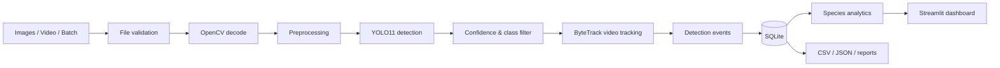

# karanverse Wildlife Detection & Monitoring System

AI-powered platform for detecting, classifying, and tracking wildlife in camera-trap images and video using **YOLO11**, **PyTorch**, **ByteTrack**, **OpenCV**, and **Streamlit**. The Streamlit UI uses the **karanverse** theme (deep indigo + violet/cyan accents).

## Features

- YOLO11 object detection with configurable weights and class filters
- ByteTrack multi-object tracking for video (via Ultralytics `model.track`)
- Image, video, and batch camera-trap workflows
- SQLite persistence for jobs, detection events, and video tracks
- Species analytics and Plotly charts (with clear metrics definitions)
- CSV / JSON export and processing reports
- Reproducible training and evaluation scripts (Ultralytics YOLO format)
- Pytest suite with mocked inference (no weight download required for tests)

## Architecture



## Repository structure

```
app.py                      # Streamlit entrypoint
configs/config.yaml         # Application configuration
src/
  detection/                # YOLO detector, pre/postprocessing
  tracking/                 # Session track statistics
  processing/               # Image, video, batch pipelines
  analytics/                # Pandas analytics & reports
  storage/                  # SQLite repository
  utils/                    # Validation & visualization
training/                   # train.py, evaluate.py, dataset.yaml
tests/                      # Unit & integration tests
data/                       # input, output, datasets (gitignored artifacts)
models/                     # Custom .pt weights (not committed)
```

## Environment setup

### macOS / Linux

```bash
python3 -m venv .venv
source .venv/bin/activate
pip install -r requirements.txt
```

### Windows

```powershell
python -m venv .venv
.venv\Scripts\activate
pip install -r requirements.txt
```

Copy optional environment overrides:

```bash
cp .env.example .env
```

## Model weights

Default config uses `yolo11n.pt` (Ultralytics auto-download on first inference).

**Limitation:** COCO-pretrained YOLO models recognize broad categories (e.g. `bear`, `elephant`, `bird`) but **do not** reliably identify many reserve-specific species (`tiger`, `leopard`, `wild_boar`, …). Configure `model.supported_classes` only for classes present in your checkpoint, or train custom weights (see below).

Place custom checkpoints under `models/` and set in `configs/config.yaml`:

```yaml
model:
  weights_path: "models/best.pt"
  supported_classes: ["tiger", "leopard", "deer"]
```

See [models/README.md](models/README.md).

## Run the application

```bash
streamlit run app.py
```

Pages: Dashboard, Image Detection, Video Tracking, Camera-Trap Batch, Analytics, Model Information, Settings.

## Example workflows

### Image detection

1. Open **Image Detection**.
2. Upload JPEG/PNG, adjust confidence.
3. Review annotated preview and detection table.
4. Download CSV and annotated image.

### Video tracking

1. Open **Video Tracking**.
2. Upload MP4/AVI (within size limits in config).
3. Process — progress bar streams frame processing.
4. Preview/download annotated video; track IDs are **session-level**, not permanent animal IDs.

### Batch camera-trap

1. Open **Camera-Trap Batch**.
2. Upload multiple images or place files in `data/input/` and extend UI to call directory processing.
3. Export consolidated CSV/JSON from stored records.

## Configuration reference

Key settings in `configs/config.yaml`:

| Section | Keys | Description |
|--------|------|-------------|
| `model` | `weights_path`, `device`, `confidence_threshold`, `iou_threshold`, `image_size`, `supported_classes` | Detector |
| `tracking` | `tracker`, `frame_sample_interval` | ByteTrack & frame sampling |
| `paths` | `database_path`, output dirs | Artifacts & SQLite |
| `image` / `video` | `max_upload_mb`, `allowed_extensions` | Upload validation |
| `batch` | `max_files`, `dedupe_by_content_hash` | Batch limits & dedupe |

Device `auto` selects CUDA, then Apple MPS, then CPU.

## Dataset preparation & training

1. Annotate data in **YOLO format** (one `.txt` per image, normalized boxes).
2. Edit `training/dataset.yaml` with your paths and class `names`.
3. Validate layout (directories must exist before training):

```bash
python training/train.py --data training/dataset.yaml --epochs 50 --batch 16
```

Training writes runs under `models/runs/` and logs metadata to SQLite (`model_runs`).

**Do not claim accuracy until you have run training/evaluation on your labeled data.**

## Evaluation

```bash
python training/evaluate.py --weights models/runs/wildlife_train/weights/best.pt --data training/dataset.yaml
```

Reports precision/recall/mAP when Ultralytics validation completes; metrics are stored in `model_runs`.

## Testing

```bash
pytest -q
```

Tests mock Ultralytics YOLO — no model download required.

## Metrics definitions

- **Detection count:** stored model detection events (boxes above threshold).
- **Track count:** unique ByteTrack IDs within a single video processing session.
- **Sighting / activity charts:** based on **observation timestamps** from EXIF or filename patterns; if unknown, charts show an informative message (no fabricated times).

These metrics are **not** population estimates — repeated detections may be the same individual.

## Troubleshooting

| Issue | Action |
|-------|--------|
| Model download fails | Check network; or place `.pt` file locally and update `weights_path` |
| CUDA OOM | Lower `image_size` or use `device: cpu` |
| No wildlife species detected | Use custom-trained weights; verify class names in `Model Information` |
| Video writer fails | Try another input codec; output uses `mp4v` |
| Empty analytics | Run at least one successful image/video/batch job |

## Licensing

- Ultralytics YOLO: [Ultralytics license](https://www.ultralytics.com/license)
- COCO pretrained weights: subject to Ultralytics/COCO terms
- Custom datasets: you must comply with the dataset license (WILDCam, Caltech Camera Traps, etc.)

Document sources and licenses for any dataset or checkpoint used in deployment.
